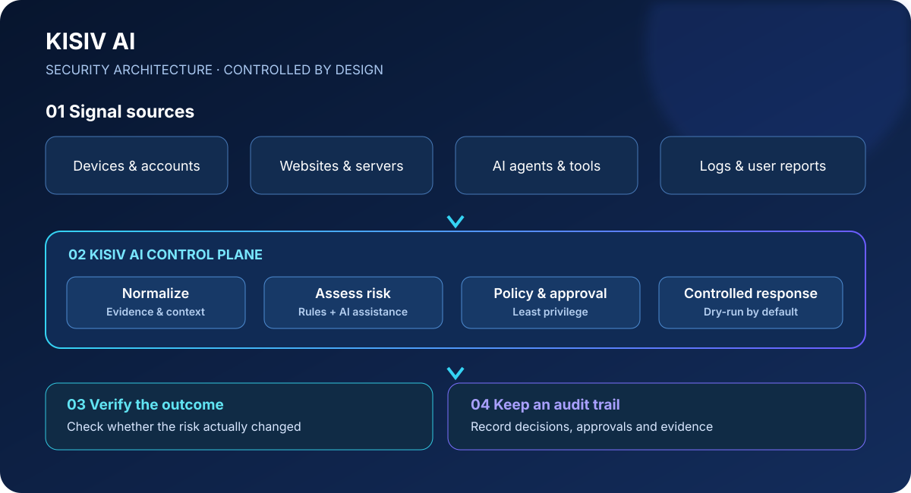

# KISIV AI

[简体中文](#简体中文) · [English](#english) · [日本語](#日本語)

> **从“发现风险”到“理解风险、控制响应、验证结果、留下证据”。**  
> An auditable security-defense platform for individuals, AI agents, and servers.  
> 個人・AI エージェント・サーバー向けの監査可能なセキュリティ防御基盤。

KISIV AI is a source-available project exploring a practical idea: security should not be a collection of disconnected alerts. It should be a controlled, explainable workflow that helps people understand what happened, why it matters, what can safely be done next, and whether the action worked.

KISIV AI 不只是一个“告警列表”或单点扫描工具。它希望逐步成为连接个人数字生活、AI Agent、网站与服务器的安全防御中枢：把分散的安全信号整理成可理解的风险，把建议变成经过授权、可撤销、可审计的操作，并用验证结果形成闭环。

> **Project status:** early MVP / active development. Product vision and planned capabilities below are not claims that every feature is already implemented.

---

## 产品视觉概览



KISIV AI 的目标是把分散的安全信号连接成受控、可解释、可验证的防御流程。上图展示的是**目标架构**，并不意味着所有模块均已实现。

## 简体中文

### 一句话介绍

**KISIV AI是一个面向个人用户、AI Agent、网站与服务器的自主式安全防御平台。** 它以事件为入口，以风险研判为核心，以受控响应为边界，以审计和验证为闭环，目标是让安全从“出了问题才处理”逐步走向“持续感知、提前判断、谨慎行动、结果可查”。

### 为什么需要KISIV AI？

今天的数字安全问题往往分散在不同地方：设备有异常、账号有可疑登录、网站有攻击流量、服务器有配置风险，AI Agent 又可能持有文件、浏览器、终端或第三方服务的访问权限。传统工具通常各自提供告警，但个人用户和小团队仍然要自己拼接线索、判断优先级、执行处置，再确认问题是否真正解决。

KISIV AI 的目标，是把这些环节连接起来。它不追求“让 AI 无限制地接管系统”，而是让自动化始终处在明确权限、可解释规则和可审计流程之内。

### 核心特点与差异化方向

- **面向个人，也面向专业环境：** 不把安全能力只留给大型企业。长期目标包括个人数字安全管家、家庭网络与设备、账号风险，以及网站、服务器和团队环境。
- **跨对象的统一视角：** 规划把设备、账号、网站、服务器与 AI Agent 的安全事件放到同一个风险视图中，帮助发现单条告警不容易体现的关联。跨平台连接器和关联分析仍属于逐步建设的方向。
- **AI 辅助判断，而非盲目自动执行：** 让系统说明风险来源、判断依据、建议动作和不确定性；高影响操作应先经过策略检查和用户授权。
- **默认安全、先模拟再行动：** 当前原型以 dry-run 模拟响应为主。未来任何真实处置能力都应具备权限边界、明确确认、超时策略和回滚设计。
- **从告警到验证的闭环：** 不止记录“发现了什么”，也规划记录“采取了什么措施、措施是否成功、风险是否下降”，避免把执行过动作误当作问题已经解决。
- **审计优先、过程可追溯：** 记录事件、风险判断、策略结果、响应尝试和验证结果，方便复盘、调试与责任追踪。
- **本地优先与数据最小化：** 优先探索本地处理和最小必要数据收集；接入云端模型或外部服务时，应明确数据边界、脱敏方式和用户授权。
- **规则与模型协作：** 规则适合表达明确的安全边界，AI 适合辅助整理上下文与解释复杂信号。目标是让模型不能绕过策略层，也不能直接生成并执行任意系统命令。
- **模块化、可扩展：** 规划以统一事件模型、风险评估、策略决策、响应执行器和审计记录为基础，逐步增加连接器，而不是把所有环境强行绑在一个巨型组件里。
- **可验证而非只看演示：** 测试、模拟响应、可复现的事件样例和明确的功能状态，应成为项目长期质量标准。

### 计划覆盖的场景

1. **个人数字安全管家**：帮助用户整理设备、账号和网络相关的安全信号，解释风险等级与建议步骤。实际设备扫描、账号连接及自动处置需按后续实现和授权情况逐项开放。
2. **AI Agent 安全卫士**：帮助管理 Agent 的工具权限、操作边界、敏感数据接触和高风险动作审批。该方向需要与 Agent 运行环境建立明确的集成接口，目前不应视为已全面实现。
3. **服务器与网站防御**：汇总安全事件、配置风险和可疑活动，辅助分析并提出防御建议；生产环境接入前必须经过独立安全审查。
4. **自动化防御中枢**：将事件、策略、响应和结果验证连接成可控工作流。自动化程度应按风险分级，而不是默认授予全系统权限。
5. **开发者与研究者工具**：提供可测试的 API、清晰的数据结构和可扩展模块，便于社区贡献检测规则、事件适配器和测试样例。

### 设计原则

- **Human-in-the-loop：** 高影响操作保留人工确认和清晰授权。
- **Least privilege：** 只申请完成任务所需的最低权限。
- **Dry-run first：** 默认模拟，先观察后行动。
- **Explainability：** 尽可能说明风险判断的依据和限制。
- **Auditability：** 关键决定和操作有记录可查。
- **Reversibility：** 对可能造成影响的动作优先设计撤销或恢复路径。
- **Privacy by design：** 避免不必要地收集、保存或上传敏感数据。
- **Defensive use only：** 只用于拥有权限的系统与防御性安全研究。

### 当前已实现的 MVP

当前仓库是早期开发原型，现阶段包含：

- FastAPI + SQLite 基础应用
- 安全事件录入与查询
- 基于规则的初步风险研判
- 默认 dry-run 的模拟响应
- 审计记录与基础测试

**当前尚未达到生产环境安全要求。** 目前不会自动封禁真实 IP、修改防火墙或执行系统命令；个人设备全面保护、跨平台实时连接、Agent 权限治理、复杂事件关联、真实自动化处置等属于后续建设方向，不能将其理解为已交付功能。

### 快速开始

需要 Python 3.11+：

```bash
python -m venv .venv
source .venv/bin/activate
python -m pip install -r requirements.txt
uvicorn app.main:app --reload --host 127.0.0.1 --port 8000
```

如需启用 API Key 校验，请在启动前设置环境变量 `KISIV_API_KEY`（建议使用足够长的随机值）；所有 `/api/v1/*` 请求需通过 `X-API-Key` 或 `Authorization: Bearer <key>` 传入。未设置该变量时不会启用认证，因此只应在本机开发环境运行，不要直接暴露到公网。

API 文档： http://127.0.0.1:8000/docs  
运行测试：`pytest`

### 项目展示与演示

- [KISIV AI 项目首页（HTML）](index.html)
- [首页部署说明（GitHub Pages）](docs/DEPLOY.md)
- [MVP 演示指南](docs/DEMO.md)
- [GitHub 社交预览图（SVG）](docs/images/kisiv-social-preview.svg)

### 项目文档

- [品牌规范与命名说明](BRAND.md)
- [产品概览与差异化设计](PRODUCT_OVERVIEW.md)
- [开发路线图](ROADMAP.md)
- [贡献指南](CONTRIBUTING.md)
- [安全问题报告](SECURITY.md)
- [商业授权说明](COMMERCIAL-LICENSE.md)
- [贡献者授权协议（CLA 草案）](CLA.md)
- [授权政策](LICENSE_POLICY.md)

### 授权与商业使用

当前代码采用 **PolyForm Noncommercial License 1.0.0**。该许可证不是 OSI 批准的标准开源许可证，因此本项目更准确地说是“源代码可见（source-available）”项目。非商业用途以 [LICENSE](LICENSE) 英文原文为准；商业用途需要另行取得书面商业授权。请阅读 [COMMERCIAL-LICENSE.md](COMMERCIAL-LICENSE.md)。

社区贡献者在 PR 合并前需要通过明确、可记录的流程同意 [CLA.md](CLA.md)。该 CLA 目前仍需完善正式的同意流程并接受专业法律审核。不要提交你无权授权的代码。

---

## English

### What is KISIV AI?

**KISIV AI is an early-stage, auditable security-defense platform for individuals, AI agents, websites, and servers.** Its design goal is to connect event intake, risk triage, controlled response, outcome verification, and audit records into one understandable workflow.

Security signals are often fragmented across devices, accounts, web services, servers, and AI agents. KISIV AI aims to help users move beyond isolated alerts: understand what happened, why it matters, which actions are appropriate, and whether those actions actually reduced risk.

### Design differentiators

- **Personal-to-professional scope:** a long-term vision spanning personal digital safety, home devices and networks, accounts, websites, servers, and teams.
- **A unified risk view:** planned event normalization and correlation across different sources, rather than disconnected alert silos.
- **AI-assisted, policy-bounded decisions:** use AI to summarize context and explain options, while deterministic policies define the allowed boundaries.
- **Dry-run first:** simulated actions by default in the current prototype; any future live response must be explicitly authorized and carefully scoped.
- **A closed-loop workflow:** plan to connect detection, triage, response, verification, and audit instead of treating an attempted action as a successful fix.
- **Explainability and auditability:** preserve the reasons behind decisions and the history of actions.
- **Local-first and privacy-conscious:** minimize data collection and make external data flows explicit.
- **Modular integration:** build around event models, risk assessment, policy decisions, response adapters, and audit trails.
- **Testable by design:** prioritize repeatable scenarios and verifiable behavior over impressive but unsafe demonstrations.

### Planned use cases

1. Personal digital-security assistant.
2. Safety and permission governance for AI agents and their tools.
3. Security-event triage for websites and servers.
4. A controlled automation hub for defensive workflows.
5. An extensible API and test framework for developers and researchers.

These are product directions, not a claim that every integration or capability is already available.

### Current MVP

- Early FastAPI + SQLite application
- Security-event intake and listing
- Starter rule-based risk triage
- Simulated response actions (dry-run by default)
- Audit records and basic tests

This is a development prototype, not production-ready security software. It does not currently block real IPs, change firewall rules, or execute system commands.

### Quick start

Python 3.11+:

```bash
python -m venv .venv
source .venv/bin/activate
python -m pip install -r requirements.txt
uvicorn app.main:app --reload --host 127.0.0.1 --port 8000
```

API docs: http://127.0.0.1:8000/docs · Tests: `pytest`

### Documentation

- [Brand guide and naming note](BRAND.md)
- [Product overview](PRODUCT_OVERVIEW.md)
- [Roadmap](ROADMAP.md)
- [Contribution guide](CONTRIBUTING.md)
- [Security reporting](SECURITY.md)
- [Commercial licensing](COMMERCIAL-LICENSE.md)
- [Contributor License Agreement draft](CLA.md)
- [License policy](LICENSE_POLICY.md)

### License and commercial use

The current code is licensed under **PolyForm Noncommercial License 1.0.0**, which is not an OSI-approved open-source license. The project is therefore source-available rather than standard open source. Commercial use requires a separate written license. See [LICENSE](LICENSE) and [COMMERCIAL-LICENSE.md](COMMERCIAL-LICENSE.md).

Contributors must explicitly agree to the CLA through a clear, recorded process before merge. The CLA and process still require legal review.

---

## 日本語

### KISIV AI とは

**KISIV AIは、個人ユーザー、AI エージェント、Web サイト、サーバーを対象とする、監査可能なセキュリティ防御基盤を目指す初期開発プロジェクトです。** イベント収集、リスク評価、制御された対応、結果の検証、監査記録を一つのワークフローにつなぐことを目標としています。

セキュリティ情報は端末、アカウント、Web サービス、サーバー、AI エージェントなどに分散しがちです。KISIV AI は、何が起きたのか、なぜ重要なのか、どの対応が適切なのか、対応によってリスクが下がったのかを理解しやすくすることを目指します。

### 主な設計上の特徴

- 個人のデジタル安全から Web サイト・サーバーまでを視野に入れた設計
- 複数の情報源を統一的に扱うイベントモデルとリスクビューの構想
- AI による説明支援と、明確なポリシーによる実行制限
- 現在の試作版では dry-run を基本とする安全重視の設計
- 検知、評価、対応、結果検証、監査をつなぐ閉ループの構想
- 判断理由と操作履歴を追跡できる監査性
- データ最小化とローカル優先の方針
- モジュール化された拡張可能な構成
- 再現可能なテストと検証を重視

これらは製品の設計方針および今後の方向性であり、すべてが実装済みという意味ではありません。

### 現在の MVP

- FastAPI と SQLite による初期アプリケーション
- セキュリティイベントの登録と一覧表示
- ルールベースの初期リスク評価
- dry-run による対応シミュレーション
- 監査記録と基本テスト

本プロジェクトは開発用プロトタイプであり、本番環境向けの安全性は保証されていません。現在、実際の IP ブロック、ファイアウォール変更、システムコマンドの実行は行いません。

### セットアップ

Python 3.11 以降が必要です。

```bash
python -m venv .venv
source .venv/bin/activate
python -m pip install -r requirements.txt
uvicorn app.main:app --reload --host 127.0.0.1 --port 8000
```

API ドキュメント: http://127.0.0.1:8000/docs · テスト: `pytest`

### ドキュメント

- [ブランドガイド](BRAND.md)
- [製品概要](PRODUCT_OVERVIEW.md)
- [開発ロードマップ](ROADMAP.md)
- [貢献ガイド](CONTRIBUTING.md)
- [セキュリティ報告](SECURITY.md)
- [商用ライセンス](COMMERCIAL-LICENSE.md)
- [CLA 草案](CLA.md)
- [ライセンスポリシー](LICENSE_POLICY.md)

### ライセンスと商用利用

現在のコードは **PolyForm Noncommercial License 1.0.0** に基づいて提供されます。これは OSI 承認のオープンソースライセンスではないため、本プロジェクトは標準的なオープンソースではなく「ソース公開型」と説明してください。商用利用には別途書面による許諾が必要です。詳細は [LICENSE](LICENSE) と [COMMERCIAL-LICENSE.md](COMMERCIAL-LICENSE.md) を参照してください。

寄稿者はマージ前に、明確かつ記録可能な手続きで CLA に明示的に同意する必要があります。CLA と同意手続きは、正式運用前に専門家による確認が必要です。

---

## Project principles / 项目原则 / プロジェクト方針

- Defensive security only; test only systems you are authorized to assess.
- Default to dry-run; never allow model-generated arbitrary shell commands.
- Keep decisions explainable and actions auditable.
- Use least privilege and explicit approval for high-impact operations.
- Prefer reversible actions and verify outcomes where possible.
- Minimize sensitive data collection and never publish secrets or production logs in issues.
- 本项目仅用于有授权的防御性安全用途。
- 許可された環境での防御的なセキュリティ用途に限定してください。

## Disclaimer

This project is provided “as is” for defensive research and development. It is not a substitute for professional security controls. Do not deploy it in production without independent security review.
